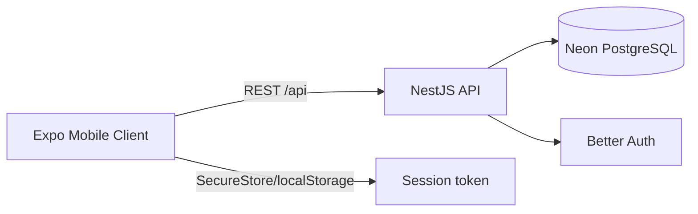
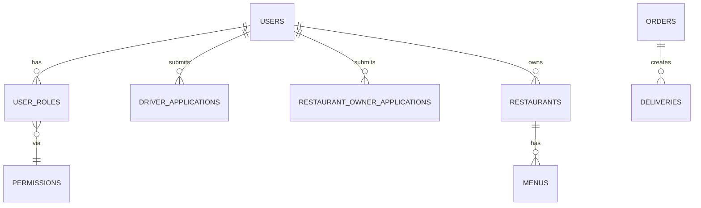

# DRIO Eats

DRIO Eats is a multi-role food delivery platform with four user experiences: Customer, Restaurant Owner, Driver, and Admin/Superadmin. It consists of an Expo (React Native) mobile client and a NestJS backend using Neon PostgreSQL via Drizzle ORM, with Better Auth for authentication and a custom RBAC layer.

## Tech stack (actual)

- Mobile: Expo SDK 58, Expo Router 58, React 19.3, React Native 0.88, TypeScript 6
- Backend: NestJS 12, Node, TypeScript 6, Drizzle ORM 1.0.0-rc.5, Neon serverless driver
- Auth: Better Auth 1.7 + @thallesp/nestjs-better-auth 2.8 (Bearer + session)
- Validation: class-validator / class-transformer (DTOs)
- DB: Neon PostgreSQL
- Shared: `@drio-eats/types`

## Repository structure

```
drio-eats/
├── apps/
│   ├── mobile-client/   # Expo app (src/app routes, src/components, src/lib, src/screens)
│   └── server/          # NestJS app (src/modules, db/schema, rbac)
├── packages/types/      # Shared TS types/enums
├── AGENTS.md            # Repo-wide agent rules
└── apps/mobile-client/AGENTS.md
```

## Architecture



## Authentication and RBAC startup flow

```mermaid
flowchart TD
  Start[App start] --> Hydrate[AuthProvider hydrates session]
  Hydrate -->|no session| Login[Login screen]
  Hydrate -->|session| Fetch[GET /api/rbac/me/roles]
  Fetch --> Ready[authorizationReady]
  Ready --> RoleHome{roleHome}
  RoleHome -->|superadmin| Admin[/(admin)/users]
  RoleHome -->|owner approved| Owner[/(owner)]
  RoleHome -->|driver approved| Driver[/(driver)]
  RoleHome -->|else| Customer[/(customer)]
```

## Database

Drizzle ORM with schema in `apps/server/src/db/schema`. Migrations via `drizzle-kit` (`pnpm db:push/pull/studio`). Key entities: users, user_roles, permissions, role_permissions, driver_applications, restaurant_owner_applications, restaurants, menus, orders, deliveries, audit_logs.



## Development setup

- Install: `pnpm install`
- Backend env: `apps/server/.env` (DATABASE_URL, BETTER_AUTH_SECRET, etc.)
- DB migrate: `cd apps/server; pnpm db:push`
- Start backend: `cd apps/server; pnpm start` (or `pnpm start:dev`)
- Start mobile: `cd apps/mobile-client; pnpm start` (Expo Go) or `pnpm web`
- Typecheck: `pnpm exec tsc --noEmit` (in each app)
- Lint: `pnpm run lint`
- Tests: `cd apps/server; pnpm test`
- Mobile export: `pnpm exec expo export --platform web`

API URL: mobile uses `EXPO_PUBLIC_API_URL` in prod; in dev web uses localhost:3000, native uses Metro host.

## Testing and verification

- Server: 99 unit tests pass (vitest). Integration/acceptance tests may require DB.
- Mobile: TypeScript pass; lint 0 errors.
- Runtime verification of auth/role flows requires Expo Go/device (not performed here).

## Known limitations

- Zod/Zustand/Redis declared in project rules but not implemented (class-validator + React Context used).
- Real-time/Socket.IO not implemented.
- Many business screens use static/mock data.
- Android runtime not verified in this environment.